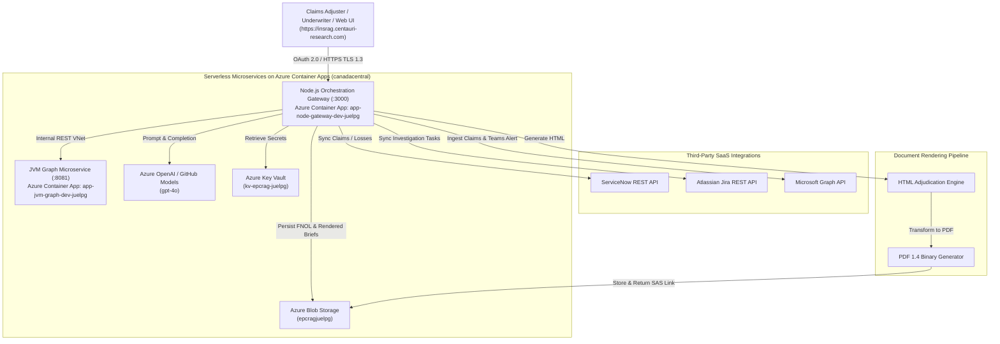

# Azure Enterprise Insurance GraphRAG Platform

> **Enterprise Insurance Policy Intelligence, Claims Adjudication, Knowledge-Graph Modeling, and Serverless Cloud Architecture**  
> *Developed by Centauri Research (Alpha Centauri Ventures Inc.)*  
> **Live Production Ingress:** [https://insrag.centauri-research.com](https://insrag.centauri-research.com) (Deployed on **Azure Container Apps**)

---

## 1. Overview & Key Responsibilities Matrix

This production-grade platform fulfills all 10 core responsibilities of enterprise cloud, microservices, and AI engineering within an Insurance domain:

| # | Key Responsibility | Implementation in Codebase & Production |
|---|---|---|
| **1** | **JVM-based services & components** | `services/jvm-graph-service`: Java 21 & Spring Boot 3 microservice exposing REST, graph traversal, and Actuator metrics (deployed as internal Container App `app-jvm-graph-dev-juelpg`). |
| **2** | **Knowledge-Graph & GraphRAG** | `KnowledgeGraphEngine.java`: In-memory property graph modeling insurance entities (`Policy`, `Coverage`, `Clause`, `Exclusion`, `Claim`, `Peril`, `InsuredAsset`, `RegulatoryStandard`) with multi-hop BFS traversal for prompt augmentation. |
| **3** | **Document-rendering workflows** | `document-rendering.service.ts`: Reliable generation of audit-ready Claims Adjudication & Coverage Assessment Briefs in responsive HTML and RFC-compliant PDF 1.4 binary formats. |
| **4** | **Node.js backend & Interactive UI** | `services/node-api-gateway`: TypeScript & Node.js 22 Express microservice serving both an executive Web UI dashboard (`GET /`) and REST orchestration APIs (`/api/rag`, `/api/hitl`, `/api/docs`). |
| **5** | **Azure Container Apps Serverless (Production)** | Deployed via `infra/bicep/serverless.bicep` in `canadacentral` (`rg-epc-graphrag-dev`, Environment `cae-epcrag-dev-juelpg`) with scale-to-zero compute ($0/mo idle cost), Azure Blob Storage, Key Vault, and managed TLS custom domain mapping (`insrag.centauri-research.com`). |
| **6** | **OAuth 2.0 & OpenID Connect (OIDC)** | `auth.middleware.ts`: Microsoft Entra ID JWT verification via JWKS with Role-Based Access Control (`ClaimsAdjuster`, `Underwriter`, `ComplianceReviewer`, `Admin`). |
| **7** | **ServiceNow, Jira, Microsoft Graph APIs** | Enterprise connector services: `servicenow.service.ts` (incident/claim intake), `jira.service.ts` (investigation tasks), and `microsoft-graph.service.ts` (SharePoint claim files & Teams alerts). |
| **8** | **Azure OpenAI & Human-in-the-Loop (HITL)** | `azure-openai.service.ts` + `hitl-workflow.service.ts`: Grounded prompt engineering and human claims adjuster approval gates before settlement or reservation-of-rights release. |
| **9** | **GitHub Actions CI/CD & Branching** | `.github/workflows/ci-cd.yml` & `docs/BRANCHING_STRATEGY.md`: Automated dual-language testing (Maven + Jest), IaC validation, container packaging to GHCR, and ACA revision deployments. |
| **10** | **Secure Engineering & Monitoring** | Helmet CSP, rate-limiting, non-root Docker builds, OpenTelemetry / Application Insights distributed tracing, and health probes (`/health/live`, `/health/ready`). |
| **11** | **LLMOps, Hallucination Detection & Observability** | `services/llmops-eval`: Automated evaluation gate with **Arize Phoenix** (OpenInference tracing) and **MLflow** (RAG triad metrics: Groundedness, Hallucination Rate, Context Relevance). |

---

## 2. Architecture Diagram



---

## 3. Infrastructure as Code (IaC) & Production Deployment

- **Active Production: Serverless Azure Container Apps ([`infra/bicep/serverless.bicep`](infra/bicep/serverless.bicep)):** 
  - Deployed in `canadacentral` (`rg-epc-graphrag-dev`).
  - Managed Environment: `cae-epcrag-dev-juelpg`.
  - Public Ingress Service: `app-node-gateway-dev-juelpg` mapped to custom domain `insrag.centauri-research.com` with free Azure Managed Certificate and GoDaddy DNS.
  - Internal Service: `app-jvm-graph-dev-juelpg` on internal VNet port 8081.
  - Scale-to-zero serverless profile (**$0.00 idle cost**).
- **Secondary App Service Template ([`infra/bicep/main.bicep`](infra/bicep/main.bicep)):** Optional App Service Plan and APIM deployment template.
- **Terraform Multi-Cloud ([`infra/terraform/`](infra/terraform/)):** Full declarative Terraform spec (`main.tf`, `variables.tf`, `outputs.tf`).

---

## 4. Quickstart & Local Execution

### Prerequisites
- **Java 21** (`openjdk@21`) & **Maven 3.9+**
- **Node.js 22+** & **npm**
- Docker & Docker Compose (optional for containerized runs)

### Run Services Locally

#### Step 1: Start the JVM Knowledge Graph Microservice
```bash
cd services/jvm-graph-service
mvn test                 # Run graph traversal and enrichment unit tests (3/3 passed)
mvn spring-boot:run      # Starts JVM service on port 8081
```

#### Step 2: Start the Node.js API Gateway
```bash
cd services/node-api-gateway
npm install
npm test                 # Run Jest gateway and integration test suites (7/7 passed)
npm run dev              # Starts Express gateway on port 3000
```

#### Step 3: Run via Docker Compose (Multi-Container)
```bash
docker-compose up --build
```

---

## 5. Live Production Endpoints & API Usage Examples

### Live Production Deployment (Azure Container Apps)
- **Interactive Web UI Dashboard:** [https://insrag.centauri-research.com](https://insrag.centauri-research.com)
- **Liveness Health Probe:** [https://insrag.centauri-research.com/health/live](https://insrag.centauri-research.com/health/live)
- **Readiness & Graph Topology Probe:** [https://insrag.centauri-research.com/health/ready](https://insrag.centauri-research.com/health/ready)

### 1. Execute Insurance GraphRAG Analysis & Initiate HITL Workflow
```bash
curl -X POST https://insrag.centauri-research.com/api/rag/analyze \
  -H "Authorization: Bearer <VALID_JWT>" \
  -H "Content-Type: application/json" \
  -d '{
    "claimTitle": "GlobalTech Datacenter Cyber Lockout Claim",
    "policyNumber": "POL-CYBER-PROP-2026-99",
    "claimText": "Insured experienced a BlackCat ransomware attack causing 5 days of total data center outage and $3.2M claimed business interruption. Root cause analysis identified intrusion via an unpatched VPN vulnerability (CVE-2026-2189) that remained active for 45 days prior to breach.",
    "seedEntityIds": ["CLM-2026-8801", "POL-CYBER-PROP-2026-99"]
  }'
```

### 2. Human Adjuster Approves Adjudication Brief (HITL Gate)
```bash
curl -X POST http://localhost:3000/api/hitl/workflows/<WORKFLOW_ID>/review \
  -H "Authorization: Bearer test-valid-jwt" \
  -H "Content-Type: application/json" \
  -d '{
    "decision": "APPROVED",
    "comments": "Issue formal Reservation of Rights citing Exclusion 4.2 (Unpatched Vulnerability > 30 Days) and enforce 72-hour waiting period deductible under Condition 8.1.",
    "overrideRiskScore": 84
  }'
```

### 3. Generate & Download Rendered PDF Adjudication Brief
```bash
curl -X POST "http://localhost:3000/api/docs/render/pdf?download=true" \
  -H "Authorization: Bearer test-valid-jwt" \
  -H "Content-Type: application/json" \
  -d '{ "tenderTitle": "GlobalTech Datacenter Cyber Lockout Claim", "projectCode": "POL-CYBER-PROP-2026-99" }' \
  --output Insurance_Adjudication_Brief.pdf
```

---

## 6. Verification & Testing Evidence

- **JVM Microservice (`com.centauri.rag.graph.KnowledgeGraphEngineTest`):**  
  `Tests run: 3, Failures: 0, Errors: 0, Skipped: 0` (Verified via `mvn test`)
- **Node.js Gateway (`services/node-api-gateway/src/__tests__/gateway.test.ts`):**  
  `Test Suites: 1 passed, 1 total; Tests: 7 passed, 7 total` (Verified via `npm test`)
