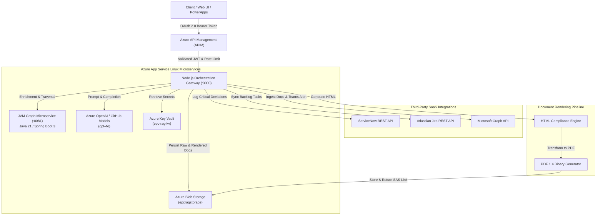

# Azure Enterprise GraphRAG Platform

> **Enterprise EPC Document Intelligence, Knowledge-Graph Modeling, and Cloud Microservices Architecture**  
> *Developed by Centauri Research (Alpha Centauri Ventures Inc.)*

---

## 1. Overview & Key Responsibilities Matrix

This production-grade platform fulfills all 10 core responsibilities of modern enterprise cloud, microservices, and AI engineering:

| # | Key Responsibility | Implementation in Codebase |
|---|---|---|
| **1** | **JVM-based services & components** | `services/jvm-graph-service`: Java 21 & Spring Boot 3 microservice exposing REST & graph traversal APIs with Actuator metrics. |
| **2** | **Knowledge-Graph & GraphRAG** | `KnowledgeGraphEngine.java`: In-memory property graph modeling EPC entities (`Document`, `Clause`, `Equipment`, `Standard`, `Vendor`, `Deviation`) and multi-hop traversal for prompt augmentation. |
| **3** | **Document-rendering workflows** | `document-rendering.service.ts`: Reliable generation of audit-ready EPC Compliance Matrices in both responsive HTML and PDF 1.4 binary formats. |
| **4** | **Node.js backend & microservices** | `services/node-api-gateway`: TypeScript & Node.js 22 Express microservice orchestrating AI, data persistence, and external connectors. |
| **5** | **Azure App Service, Blob, KV, APIM, Entra ID** | `infra/bicep/main.bicep`: Infrastructure as Code provisioning Linux App Services, Blob containers, Key Vault, APIM instance, and App Insights. |
| **6** | **OAuth 2.0 & OpenID Connect (OIDC)** | `auth.middleware.ts`: Microsoft Entra ID JWT verification via JWKS with Role-Based Access Control (`Engineer`, `ComplianceReviewer`, `Admin`). |
| **7** | **ServiceNow, Jira, Microsoft Graph APIs** | Enterprise connector services: `servicenow.service.ts` (incidents), `jira.service.ts` (issues), and `microsoft-graph.service.ts` (SharePoint docs & Teams cards). |
| **8** | **Azure OpenAI & Human-in-the-Loop (HITL)** | `azure-openai.service.ts` + `hitl-workflow.service.ts`: Grounded prompt engineering and human engineering approval gates before release. |
| **9** | **GitHub Actions CI/CD & Branching** | `.github/workflows/ci-cd.yml` & `BRANCHING_STRATEGY.md`: Automated dual-language testing, Bicep linting, and zero-downtime staging slot swaps. |
| **10** | **Secure Engineering & Monitoring** | Helmet, rate-limiting, non-root Docker builds, OpenTelemetry / Application Insights distributed tracing, and health probes (`/health/live`, `/health/ready`). |

---

## 2. Architecture Diagram



---

## 3. Quickstart & Local Execution

### Prerequisites
- **Java 21** (`openjdk@21`) & **Maven 3.9+**
- **Node.js 22+** & **npm**
- Docker & Docker Compose (optional for containerized runs)

### Run Services Locally

#### Step 1: Start the JVM Knowledge Graph Microservice
```bash
cd services/jvm-graph-service
mvn test                 # Run graph traversal and enrichment unit tests
mvn spring-boot:run      # Starts JVM service on port 8081
```

#### Step 2: Start the Node.js API Gateway
```bash
cd services/node-api-gateway
npm install
npm test                 # Run all 7 Jest gateway and integration test suites
npm run dev              # Starts Express gateway on port 3000
```

#### Step 3: Run via Docker Compose (Multi-Container)
```bash
docker-compose up --build
```

---

## 4. API Usage Examples

### 1. Execute GraphRAG Analysis & Initiate HITL Workflow
```bash
curl -X POST http://localhost:3000/api/rag/analyze \
  -H "Authorization: Bearer test-valid-jwt" \
  -H "Content-Type: application/json" \
  -d '{
    "tenderTitle": "GAIL Bio-CNG Panipat Package",
    "projectCode": "CR-EPC-2026-09",
    "tenderText": "Supply 1200 Nm3/hr Biogas Screw Compressor complying with OISD-179. Liquidated Damages shall be 0.5% per week up to 10% under GCC 24.1.",
    "seedEntityIds": ["EQ-C-101", "CLS-GCC-24.1"]
  }'
```

### 2. Human Reviewer Approves Deviation (HITL Gate)
```bash
curl -X POST http://localhost:3000/api/hitl/workflows/<WORKFLOW_ID>/review \
  -H "Authorization: Bearer test-valid-jwt" \
  -H "Content-Type: application/json" \
  -d '{
    "decision": "APPROVED",
    "comments": "OISD temperature deviation accepted provided OEM delivers secondary cooler.",
    "overrideRiskScore": 65
  }'
```

### 3. Generate & Download Rendered PDF Report
```bash
curl -X POST "http://localhost:3000/api/docs/render/pdf?download=true" \
  -H "Authorization: Bearer test-valid-jwt" \
  -H "Content-Type: application/json" \
  -d '{ "tenderTitle": "GAIL Bio-CNG Panipat Package" }' \
  --output EPC_Compliance_Matrix.pdf
```

---

## 5. Verification & Testing Evidence

- **JVM Microservice (`com.centauri.rag.graph.KnowledgeGraphEngineTest`):**  
  `Tests run: 3, Failures: 0, Errors: 0, Skipped: 0` (Verified via `mvn test`)
- **Node.js Gateway (`services/node-api-gateway/src/__tests__/gateway.test.ts`):**  
  `Test Suites: 1 passed, 1 total; Tests: 7 passed, 7 total` (Verified via `jest`)
