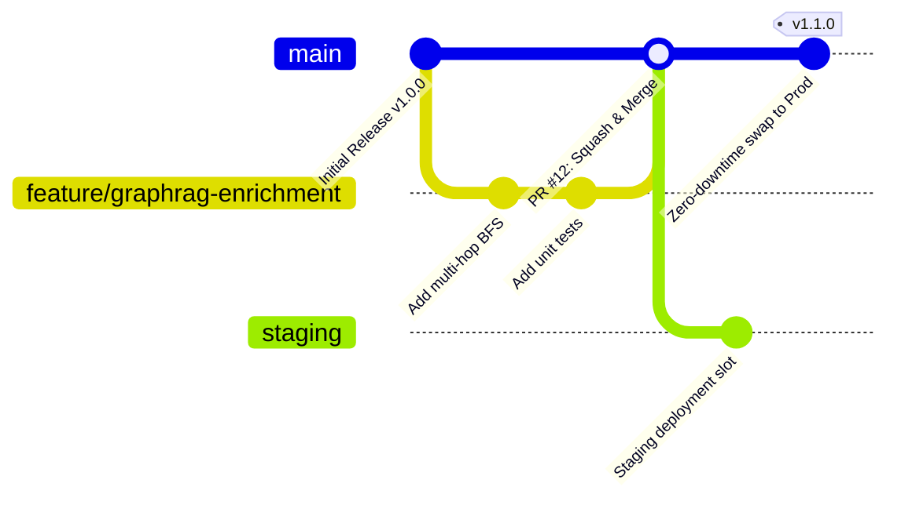

# Production Git Branching & Release Strategy

This repository adopts a **Trunk-Based Development** model augmented with environment stabilization branches and Azure App Service deployment slots.

## Branch Governance Rules
1. **`main` (Production):**
   - Protected branch. Direct pushes are disabled.
   - Requires at least 1 peer code review approval.
   - All status checks must pass (JVM Maven tests, Node.js Jest tests, Bicep linting).
   - Linear history enforced via **Squash and Merge**.

2. **`feature/*` / `fix/*` (Working Branches):**
   - Branch from current `main`.
   - Lifespan strictly capped at < 48 hours to prevent merge drift.
   - Must include unit tests verifying new functionality.

3. **Staging & Production Deployment Slots:**
   - Every deployment to `main` deploys first to the `staging` slot of the Azure App Service.
   - Automated health checks ping `/health/ready`.
   - On passing probe verification, an atomic swap is executed with the production slot, ensuring 0 ms downtime.
