# Domain & Knowledge Graph Modeling Specification: Enterprise Insurance

## 1. Domain Entities & Taxonomy (Insurance & Claims Intelligence)

### Entity Types (Nodes)
- **`Document`**: Policy wording, endorsement schedule, First Notice of Loss (FNOL), adjuster assessment, forensic cybersecurity report, or statutory regulation.
  - Properties: `id`, `name`, `documentType` (`POLICY_SCHEDULE`, `ENDORSEMENT`, `CLAIM_FNOL`, `ADJUSTER_REPORT`, `FORENSIC_AUDIT`, `REGULATION`), `version`, `storageUri`.
- **`Policy`**: Master insurance contract issued to an insured commercial entity.
  - Properties: `id`, `policyNumber`, `policyholder`, `effectiveDate`, `expirationDate`, `aggregateLimit`, `underwriter`.
- **`Coverage`**: Specific coverage line or insuring agreement.
  - Properties: `id`, `name`, `category` (`PROPERTY_DAMAGE`, `BUSINESS_INTERRUPTION`, `CYBER_EXTORTION`, `THIRD_PARTY_LIABILITY`, `ERRORS_AND_OMISSIONS`), `limitAmount`, `deductibleAmount`.
- **`Clause`**: Operational clause, condition, or warranty within a policy.
  - Properties: `id`, `clauseNumber`, `title`, `text`, `category` (`WAITING_PERIOD`, `CO_INSURANCE`, `DEDUCTIBLE`, `NOTICE_REQUIREMENT`, `SUBROGATION`), `strictness` (`MANDATORY`, `CONDITIONAL`).
- **`Exclusion`**: Specific legal or peril exclusion negating or restricting coverage.
  - Properties: `id`, `code`, `title`, `description`, `exclusionCategory` (`CYBER_HYGIENE`, `WAR_HOSTILITIES`, `WEAR_TEAR`, `WATER_SURFACE`, `INTENTIONAL_ACTS`), `severity` (`TOTAL_BAR`, `SUB_LIMIT_TRIGGER`).
- **`Claim`**: First Notice of Loss or formal loss claim filed by an insured party.
  - Properties: `id`, `claimNumber`, `incidentDate`, `filedDate`, `claimedAmount`, `status` (`FILED`, `UNDER_ADJUDICATION`, `DISPUTED`, `APPROVED`, `REJECTED`).
- **`Peril`**: The proximate cause or manifestation of loss.
  - Properties: `id`, `name`, `perilType` (`RANSOMWARE_ATTACK`, `WINDSTORM`, `FIRE`, `EQUIPMENT_BREAKDOWN`, `DATA_BREACH`).
- **`InsuredAsset`**: The physical or digital asset subject to risk.
  - Properties: `id`, `assetName`, `assetType` (`DATACENTER`, `COMMERCIAL_BUILDING`, `FLEET`, `INDUSTRIAL_FACILITY`), `declaredValue`, `location`.
- **`RegulatoryStandard`**: Statutory insurance regulations and model acts.
  - Properties: `id`, `code` (`NAIC_MDL_668`, `SOLVENCY_II`, `STATE_INSURANCE_CODE`), `jurisdiction`, `authority`.

### Relationship Types (Edges)
- `(Policy)-[:CONTAINS_COVERAGE]->(Coverage)`
- `(Coverage)-[:SUBJECT_TO]->(Exclusion)`
- `(Coverage)-[:GOVERNED_BY]->(Clause)`
- `(Claim)-[:FILED_UNDER]->(Policy)`
- `(Claim)-[:CAUSED_BY]->(Peril)`
- `(Claim)-[:INVOLVES_ASSET]->(InsuredAsset)`
- `(Claim)-[:TRIGGERS_EXCLUSION]->(Exclusion)`
- `(Claim)-[:EVALUATED_AGAINST]->(RegulatoryStandard)`

---

## 2. GraphRAG Retrieval Mechanics in Insurance

```mermaid
graph LR
    ClaimQuery["Claim FNOL / Policy Adjudication Query"] --> SeedExtraction["Entity Extraction (Policy, Peril, Asset)"]
    SeedExtraction --> SeedNodes["Seed Graph Nodes"]
    SeedNodes --> MultiHop["Multi-Hop Graph Traversal (JVM Engine)"]
    MultiHop --> Subgraph["Extract Subgraph (Coverages + Deductibles + Exclusions + Perils)"]
    Subgraph --> AIContext["Attributed Knowledge Graph Context"]
    AIContext --> LLM["Azure OpenAI (GPT-4o)"]
    LLM --> VerifiedDecision["Adjudication Decision & Audit-Ready Coverage Brief"]
```

1. **Seed Entity Identification**: Ingestion maps the claim to its policy (`Policy`), claimed peril (`Peril`), and affected property (`InsuredAsset`).
2. **K-Hop Neighborhood Expansion**: JVM Graph Engine traverses connected relationships up to 2 hops deep to identify relevant coverage lines, applicable waiting periods/deductibles, and potential exclusion triggers.
3. **Graph Serialization**: Subgraph is formatted as a structured knowledge context block for Azure OpenAI prompt generation.
4. **Deterministic Attribution**: Responses cite exact policy clause numbers, exclusion codes, and deductible rules with 100% legal grounding.
