# Domain & Knowledge Graph Modeling Specification

## 1. Domain Entities & Taxonomy (EPC Industrial Domain)

### Entity Types (Nodes)
- **`Document`**: Tender specification, vendor submittal, standard code, or contractual addendum.
  - Properties: `id`, `name`, `documentType` (`TENDER`, `SPECIFICATION`, `VENDOR_SUBMITTAL`, `STANDARD`), `version`, `storageUri`.
- **`Clause`**: Atomic legal, commercial, or technical clause within a document.
  - Properties: `id`, `clauseNumber`, `text`, `category` (`LIQUIDATED_DAMAGES`, `BATTERY_LIMIT`, `SAFETY`, `WARRANTY`, `SCOPE`), `riskLevel` (`LOW`, `MEDIUM`, `HIGH`, `CRITICAL`).
- **`Equipment`**: Physical equipment, tag, or plant functional package.
  - Properties: `id`, `tagNumber`, `name`, `system` (`FEEDSTOCK`, `DIGESTION`, `UPGRADING`, `COMPRESSION`, `BOP`), `designCapacity`, `operatingPressure`.
- **`Standard`**: Statutory, national, or industry standard code.
  - Properties: `id`, `code` (`PESO_SMPV`, `ASME_SEC_VIII`, `OISD_179`, `API_618`), `title`, `issuingBody`.
- **`Vendor`**: OEM or subcontractor bidding or submitting equipment.
  - Properties: `id`, `name`, `tier`, `country`.
- **`Deviation`**: Discrepancy between vendor quote/submittal and tender/standard specification.
  - Properties: `id`, `title`, `description`, `severity` (`ACCEPTED`, `COMMERCIAL_RISK`, `UNACCEPTABLE_TECHNICAL`), `costImpact`.

### Relationship Types (Edges)
- `(Document)-[:CONTAINS]->(Clause)`
- `(Clause)-[:SPECIFIES]->(Equipment)`
- `(Clause)-[:GOVERNED_BY]->(Standard)`
- `(Vendor)-[:QUOTES]->(Equipment)`
- `(Vendor)-[:SUBMITS]->(Document)`
- `(Vendor)-[:DEVIATES_FROM]->(Clause)`
- `(Deviation)-[:AFFECTS]->(Equipment)`
- `(Deviation)-[:VIOLATES]->(Standard)`

---

## 2. GraphRAG Retrieval Mechanics

```mermaid
graph LR
    UserQuery["User Prompt / Tender Query"] --> EmbedQuery["Vector & Keyword Extraction"]
    EmbedQuery --> VectorMatch["Find Top-K Direct Clauses"]
    VectorMatch --> SeedNodes["Seed Graph Nodes"]
    SeedNodes --> MultiHop["Multi-Hop Graph Traversal (JVM Engine)"]
    MultiHop --> Subgraph["Extract Contextual Subgraph (Equipment + Standards + Deviations)"]
    Subgraph --> AIContext["Enriched Prompt Context"]
    AIContext --> LLM["Azure OpenAI / GitHub Models"]
    LLM --> VerifiedAnswer["Attributed Response & Compliance Report"]
```

1. **Seed Entity Identification**: Ingestion & semantic search locates primary matching nodes (`Clause`, `Equipment`).
2. **K-Hop Neighborhood Expansion**: JVM Graph Engine traverses connected relationships up to 2 hops deep to gather related standards, governing rules, and vendor deviations.
3. **Graph Serialization**: Subgraph is formatted as a structured knowledge context block for Azure OpenAI prompt generation.
4. **Deterministic Attribution**: Responses cite exact entity IDs, document pages, and relationship paths.
