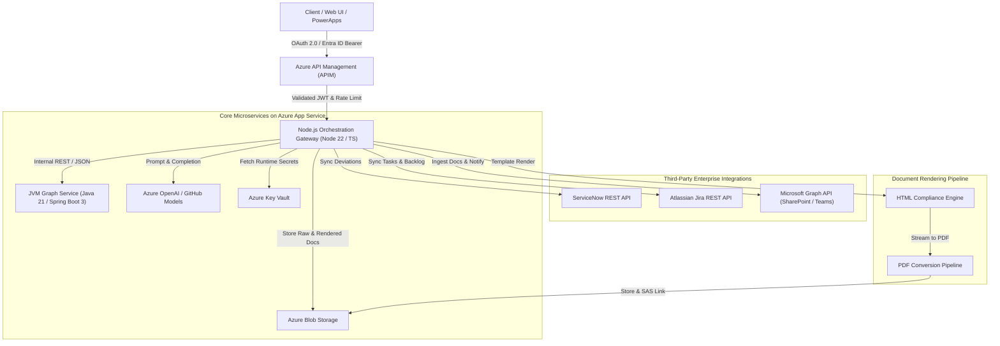

# Project Charter: Azure Enterprise GraphRAG Platform

## 1. Executive Summary & Context
- **Organization:** Centauri Research (Legal Entity: Alpha Centauri Ventures Inc.).
- **Domain:** Enterprise Engineering, Procurement & Construction (EPC), Multi-Cloud Architecture, and AI Industrial Intelligence.
- **Mission:** Build a resilient, dual-microservice GraphRAG platform that unifies JVM-based knowledge graph modeling, Node.js API orchestration, Azure cloud services (App Service, Blob, Key Vault, Entra ID, APIM), enterprise integrations (ServiceNow, Jira, Microsoft Graph), and human-in-the-loop (HITL) document-rendering workflows.

---

## 2. Key Responsibilities & Capabilities Addressed
1. **JVM-based Microservices:** High-throughput Spring Boot 3 / Java 21 knowledge-graph engine deployed as an Azure microservice.
2. **Knowledge Graph Modeling & GraphRAG:** Property graph schema representing EPC documents, clauses, equipment tags, engineering standards, vendor quotes, and deviations with multi-hop graph traversal and AI context enrichment.
3. **Document-Rendering Workflows:** High-fidelity HTML & PDF transformation pipelines delivering audit-ready EPC compliance matrices and executive deviation briefs.
4. **Node.js Orchestration Gateway:** TypeScript REST API microservice coordinating AI workflows, document rendering, and external SaaS connectors.
5. **Azure Cloud Native:** Production deployments targeting Azure App Service, Azure Blob Storage (documents & outputs), Azure Key Vault (secrets), Azure API Management (APIM policies), and Microsoft Entra ID.
6. **Enterprise Authentication & Authorization:** OAuth 2.0 and OpenID Connect (OIDC) JWT validation with Entra ID, including role-based access control (RBAC).
7. **Enterprise Connectors:** Out-of-the-box integrations for ServiceNow (Incident/Change sync), Jira (Task/Issue sync), and Microsoft Graph (SharePoint document ingestion & Teams/Outlook notifications).
8. **AI-Enabled Workflows & HITL:** Azure OpenAI / GitHub Models prompt pipelines with deterministic citations and interactive Human-in-the-Loop review gates.
9. **CI/CD & DevOps:** GitHub Actions deployment pipelines, Trunk/GitFlow branching strategy, and Azure Bicep Infrastructure-as-Code (IaC).
10. **Secure Engineering & Observability:** Strict input validation, zero-trust token verification, non-root containers, health checks, and OpenTelemetry / Azure Monitor metrics.

---

## 3. Architecture Overview

---

## 4. Key Performance Indicators (KPIs)
| Metric | Baseline | Target |
|---|---|---|
| Graph Neighborhood Retrieval (2-hop) | N/A | < 25 ms (JVM in-memory index) |
| End-to-End Tender Risk & Graph Analysis | 4-8 days | < 60 seconds |
| PDF Document Rendering Time | Manual formatting (days) | < 3.5 seconds |
| HITL Workflow Audit Trail Grounding | 0% | 100% clause & equipment attribution |
