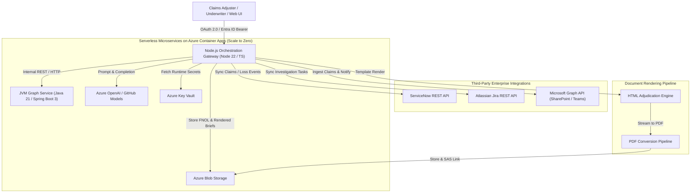

# Project Charter: Azure Enterprise Insurance GraphRAG Platform

## 1. Executive Summary & Context
- **Organization:** Centauri Research (Legal Entity: Alpha Centauri Ventures Inc.).
- **Domain:** Enterprise Commercial Insurance, Multi-Line Policy Underwriting, Automated Claims Adjudication, and Regulatory Compliance.
- **Mission:** Build a resilient, dual-microservice GraphRAG platform that unifies JVM-based knowledge graph modeling of insurance policies, coverages, exclusions, and claims, Node.js API orchestration, Azure serverless cloud services (Container Apps, Blob Storage, Key Vault, Entra ID), enterprise integrations (ServiceNow, Jira, Microsoft Graph), and human-in-the-loop (HITL) claim-adjudication workflows.

---

## 2. Key Responsibilities & Capabilities Addressed
1. **JVM-based Microservices:** High-throughput Spring Boot 3 / Java 21 knowledge-graph engine deployed on Azure Container Apps.
2. **Knowledge Graph Modeling & GraphRAG:** Property graph schema representing insurance policies, insuring agreements, conditions, deductibles, exclusions, loss perils, and claimant FNOL data with multi-hop graph traversal and AI context enrichment.
3. **Document-Rendering Workflows:** High-fidelity HTML & PDF transformation pipelines delivering audit-ready claims adjudication briefs and coverage dispute matrices.
4. **Node.js Orchestration Gateway:** TypeScript REST API microservice coordinating AI workflows, document rendering, and external SaaS connectors.
5. **Azure Cloud Native (Serverless):** Scale-to-zero serverless deployments on Azure Container Apps, Azure Blob Storage (raw claim files & rendered briefs), Azure Key Vault (secrets), and Microsoft Entra ID.
6. **Enterprise Authentication & Authorization:** OAuth 2.0 and OpenID Connect (OIDC) JWT validation with Entra ID, including role-based access control (RBAC).
7. **Enterprise Connectors:** Out-of-the-box integrations for ServiceNow (Incident/Loss intake sync), Jira (Claims investigation task sync), and Microsoft Graph (SharePoint claim file ingestion & Teams adjustor notifications).
8. **AI-Enabled Workflows & HITL:** Azure OpenAI / GitHub Models prompt pipelines with deterministic policy citations and interactive Human-in-the-Loop adjustor review gates.
9. **CI/CD & DevOps:** GitHub Actions deployment pipelines and Azure Bicep Infrastructure-as-Code (IaC).
10. **Secure Engineering & Observability:** Strict input validation, zero-trust token verification, non-root containers, health checks, and OpenTelemetry / Azure Monitor metrics.

---

## 3. Architecture Overview

---

## 4. Key Performance Indicators (KPIs)
| Metric | Baseline | Target |
|---|---|---|
| Graph Neighborhood Retrieval (2-hop) | N/A | < 25 ms (JVM in-memory index) |
| End-to-End Claim Adjudication & Exclusion Screening | 3-5 days | < 60 seconds |
| PDF Adjudication Brief Rendering Time | Manual formatting (hours) | < 3.5 seconds |
| HITL Adjudication Audit Trail Grounding | 0% | 100% policy clause & exclusion attribution |
